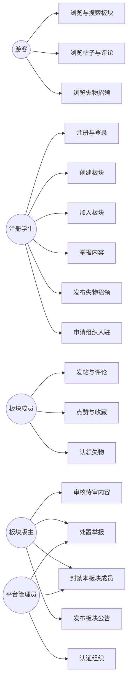
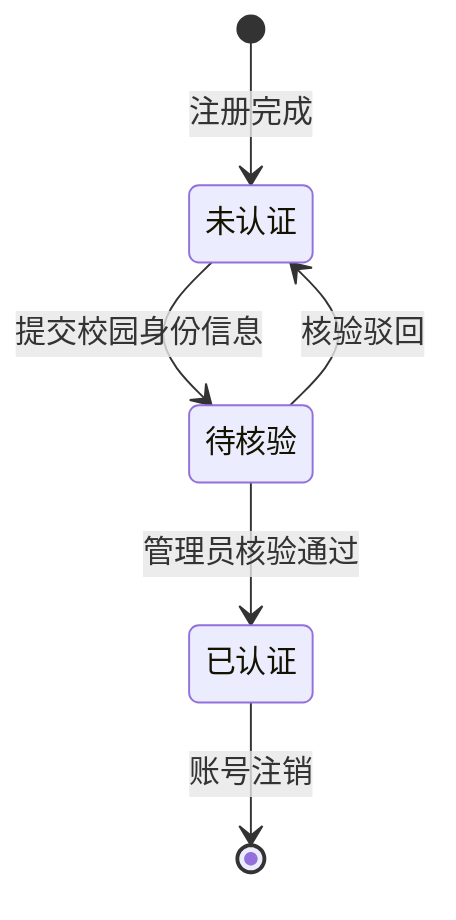
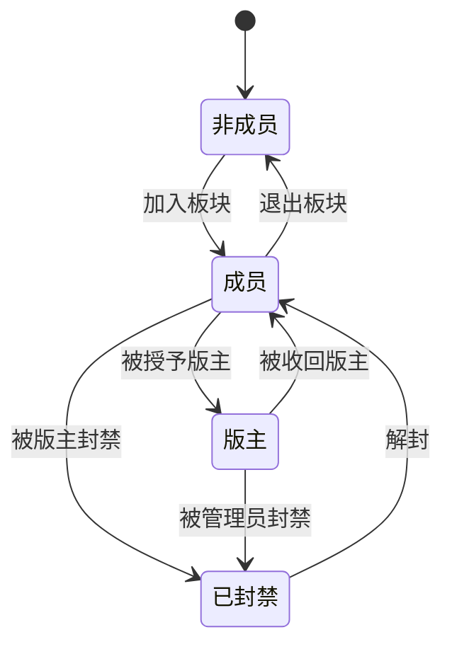
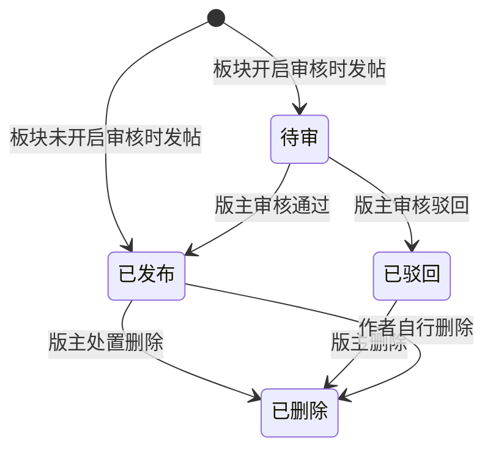
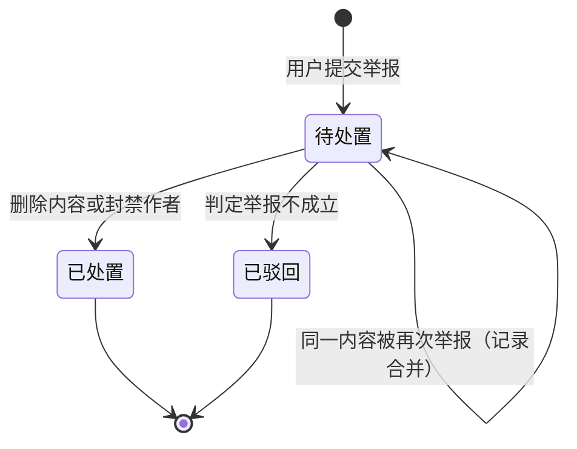
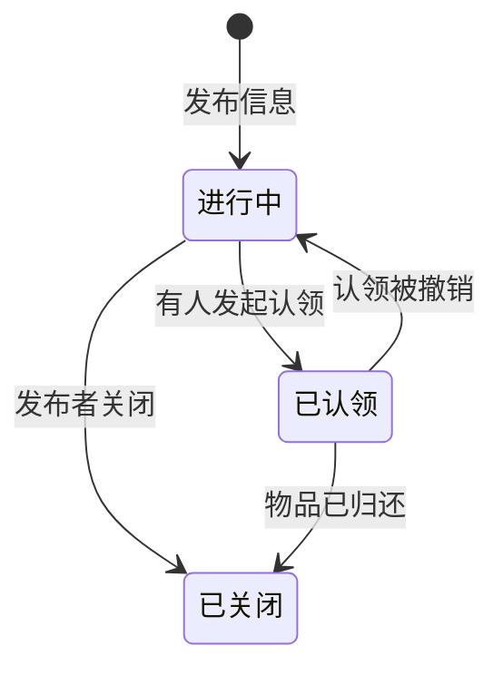
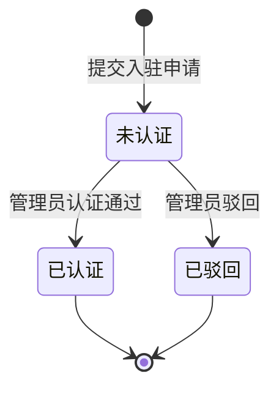
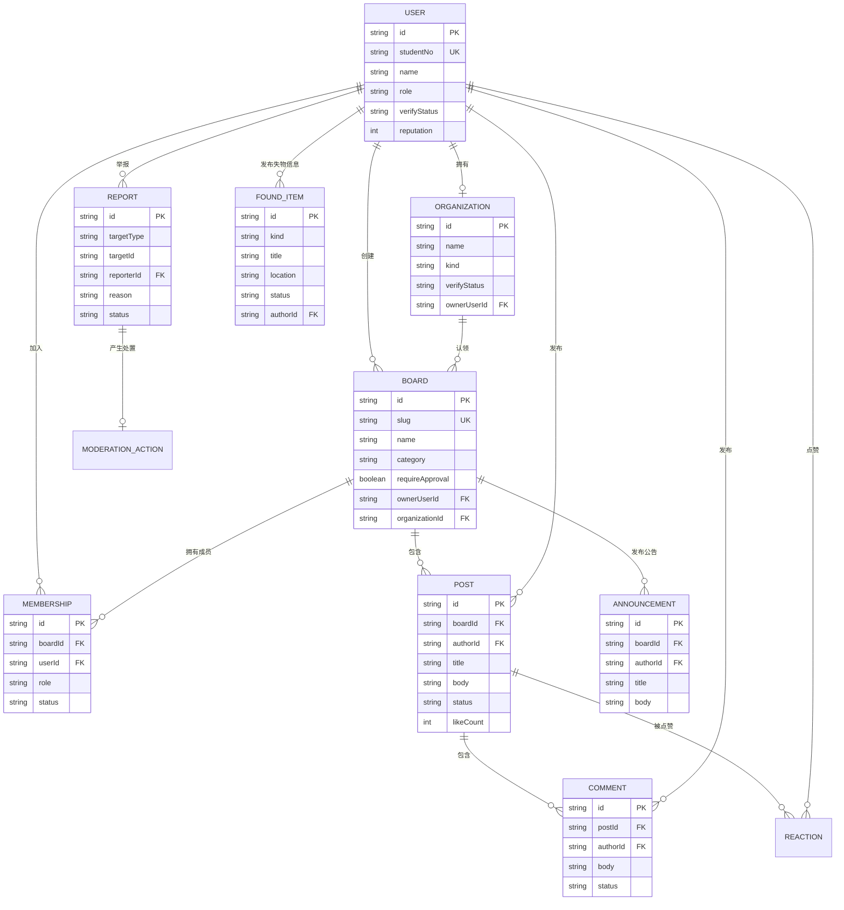

# 需求分析报告

> 项目：SchoolLifeComplex 校园兴趣社区
> 编写：系统分析员3
> 版本：初稿
> 需求来源：项目组自身所在的兴趣小组（首批场景）、竞品分析结论、可行性研究报告的约束条件
> 说明：本报告中的图形使用 Mermaid 描述，可在支持 Mermaid 的编辑器中预览，或粘贴到 mermaid.live 导出为课程要求的图片格式。

---

## 一、引言

### 1.1 目的

把《前景与范围报告》确定的首期范围，转化为可验证的功能需求、数据需求与非功能需求。本报告是总体设计与详细设计的直接输入。

### 1.2 需求来源与采集方式

| 来源 | 采集方式 | 得到的需求 |
| --- | --- | --- |
| 项目组所在的兴趣小组 | 成员访谈与自身使用经验 | 内容留存、新人看不到历史、群消息淹没重点 |
| 注册社团的招新场景 | 公开信息整理 | 招新有固定入口、活动通知能触达非群成员 |
| 竞品分析结论 | 对比已有产品 | 内容必须可搜索；组织需要可确认的身份 |
| 可行性研究报告 | 约束条件 | 不接入官方系统；治理闭环必须在首期；不强制实名 |

### 1.3 术语

| 术语 | 定义 |
| --- | --- |
| 组织 | 任何有管理者的群体。学生自建的兴趣小组与注册社团同属组织，后者可获认证标识 |
| 板块 | 内容组织的基本单元，有唯一的名称与地址标识，归属于创建者 |
| 成员 | 已加入某个板块的用户 |
| 版主 | 板块内被授予管理权限的成员 |
| 双通道 | 学生可自建板块；组织认证后可认领或开设官方板块 |
| 待审 | 内容已提交但因板块配置或举报而不可公开显示的状态 |
| 处置 | 版主或管理员对举报作出的判定与动作 |

---

## 二、用户角色与权限

### 2.1 角色定义

| 角色 | 获得方式 | 说明 |
| --- | --- | --- |
| 游客 | 无需登录 | 可浏览，不可参与 |
| 注册学生 | 注册并通过模拟校园身份校验 | 平台的基础参与者 |
| 板块成员 | 主动加入某个板块 | 在该板块内获得发帖权限 |
| 板块版主 | 由板块创建者授予 | 在该板块内拥有治理权限 |
| 平台管理员 | 系统预置 | 跨板块治理与组织认证 |

### 2.2 权限矩阵

| 操作 | 游客 | 注册学生 | 板块成员 | 板块版主 | 平台管理员 |
| --- | --- | --- | --- | --- | --- |
| 浏览板块列表与搜索结果 | 可 | 可 | 可 | 可 | 可 |
| 浏览已发布帖子与评论 | 可 | 可 | 可 | 可 | 可 |
| 查看待审内容 | 不可 | 仅本人 | 不可 | 本板块可 | 可 |
| 创建板块 | 不可 | 可 | 可 | 可 | 可 |
| 加入板块 | 不可 | 可 | 已具备 | 已具备 | 已具备 |
| 发帖 / 评论 / 点赞 | 不可 | 不可 | 可 | 可 | 可 |
| 举报内容 | 不可 | 可 | 可 | 可 | 可 |
| 发布失物招领 | 不可 | 可 | 可 | 可 | 可 |
| 认领失物 | 不可 | 可 | 可 | 可 | 可 |
| 申请组织入驻 | 不可 | 可 | 可 | 可 | 可 |
| 认领板块为官方阵地 | 不可 | 仅组织所有者 | 不可 | 不可 | 不可 |
| 审核待审内容 | 不可 | 不可 | 不可 | 本板块可 | 可 |
| 处置举报 | 不可 | 不可 | 不可 | 本板块可 | 全站可 |
| 删除内容 | 不可 | 仅本人内容 | 仅本人内容 | 本板块可 | 可 |
| 封禁成员 | 不可 | 不可 | 不可 | 本板块可 | 全站可 |
| 发布板块公告 | 不可 | 不可 | 不可 | 可 | 可 |
| 认证组织 | 不可 | 不可 | 不可 | 不可 | 可 |

### 2.3 权限模型的设计原则

1. **读开放，写受限**：浏览与搜索不设门槛，参与需要加入。这是"内容可被发现"这一价值主张的直接体现。
2. **治理就近**：板块内的治理由版主完成，管理员只在举报无法在本板块闭环时介入。
3. **权限不叠加在身份上，而是叠加在关系上**：版主身份是"某个板块的版主"，不是用户属性。因此用户可以是一个板块的版主、另一个板块的普通成员。

---

## 三、功能需求

### 3.1 M1 身份与准入

| 编号 | 需求 | 优先级 | 验收标准 |
| --- | --- | --- | --- |
| FR-M1-01 | 用户可用学号、姓名与密码注册 | 高 | 重复学号注册被拒绝并给出提示 |
| FR-M1-02 | 用户可登录与退出 | 高 | 登录后会话保持；退出后受限操作返回未登录错误 |
| FR-M1-03 | 系统维护校园身份认证状态 | 中 | 状态取值：未认证 / 待核验 / 已认证；状态在个人主页可见 |
| FR-M1-04 | 用户可查看本人主页 | 中 | 展示姓名、认证状态、加入的板块、发布的内容 |
| FR-M1-05 | 系统按角色与关系判定权限 | 高 | 越权请求返回 403 且不产生副作用 |
| FR-M1-06 | 管理员可调整用户信誉分 | 低 | 信誉分变化有记录 |

**说明**：本设计**不做**强制实名。理由见可行性研究报告 4.1 节：接入真实校园身份核验需要校方数据授权，学生项目不具备条件。认证状态在本设计中是"平台内部的可信标记"，失物招领等场景的可信度由认证状态与信誉共同承担。

### 3.2 M2 兴趣板块

| 编号 | 需求 | 优先级 | 验收标准 |
| --- | --- | --- | --- |
| FR-M2-01 | 注册用户可创建板块 | 高 | 创建者成为该板块首位成员，且默认成为版主 |
| FR-M2-02 | 板块可设置名称、简介、分类与发帖审核开关 | 高 | 名称唯一，重复返回错误 |
| FR-M2-03 | 任何人可浏览板块列表 | 高 | 无需登录 |
| FR-M2-04 | 任何人可按关键字搜索板块 | 高 | 搜索匹配板块名称与简介 |
| FR-M2-05 | 任何人可按分类筛选板块 | 中 | 分类由系统预置固定取值 |
| FR-M2-06 | 注册学生可加入板块 | 高 | 加入后成为成员，可发帖 |
| FR-M2-07 | 版主可授予或收回他人版主身份 | 中 | 只有本板块版主可操作 |
| FR-M2-08 | 版主可封禁本板块成员 | 中 | 封禁后该成员在本板块内不能发帖与评论 |
| FR-M2-09 | 系统记录板块的成员数 | 低 | 板块列表与详情展示 |

**板块分类预置取值**：游戏、动漫、文体、学习、生活、其他。

### 3.3 M3 内容交流

| 编号 | 需求 | 优先级 | 验收标准 |
| --- | --- | --- | --- |
| FR-M3-01 | 板块成员可发帖 | 高 | 需标题与正文；未加入者发帖返回 403 |
| FR-M3-02 | 板块可配置发帖是否需要审核 | 高 | 开启后新帖状态为待审，仅作者与版主可见 |
| FR-M3-03 | 版主可审核通过或驳回待审帖子 | 高 | 审核后状态变为已发布或已驳回 |
| FR-M3-04 | 成员可评论帖子 | 高 | 被封禁成员不可评论 |
| FR-M3-05 | 用户可对帖子点赞与取消点赞 | 中 | 同一用户对同一帖子只能点赞一次 |
| FR-M3-06 | 注册用户可举报帖子或评论 | 高 | 举报需选择原因；举报后进入待处置队列 |
| FR-M3-07 | 版主可删除本板块内容 | 高 | 删除后内容不再对普通用户可见 |
| FR-M3-08 | 帖子列表支持按最新与最热排序 | 低 | 最热按点赞与评论数排序 |
| FR-M3-09 | 任何人可搜索帖子 | 中 | 匹配标题与正文 |

### 3.4 M4 组织与活动

| 编号 | 需求 | 优先级 | 验收标准 |
| --- | --- | --- | --- |
| FR-M4-01 | 注册用户可申请组织入驻 | 中 | 提交组织名称、类型、简介；类型取值为注册社团 / 自建小组 |
| FR-M4-02 | 管理员可认证或驳回组织申请 | 中 | 认证后组织获得认证标识 |
| FR-M4-03 | 组织所有者可认领板块为官方阵地 | 中 | 认领后板块显示所属组织与认证标识；一个板块只能被一个组织认领 |
| FR-M4-04 | 任何人都可在板块页看到认证标识 | 中 | 认证板块与普通板块在界面上可区分 |
| FR-M4-05 | 版主可发布板块公告 | 中 | 公告在板块页置顶展示 |
| FR-M4-06 | 用户可订阅板块公告 | 低 | 订阅后在"我的订阅"中可见 |
| FR-M4-07 | 组织可发布招新信息 | 低 | 以板块公告形式承载；完整的招新报名流程不在本期 |

### 3.5 M5 信息互助

| 编号 | 需求 | 优先级 | 验收标准 |
| --- | --- | --- | --- |
| FR-M5-01 | 注册用户可发布失物或招领信息 | 中 | 需填写标题、描述、地点、联系方式 |
| FR-M5-02 | 任何人可浏览与搜索失物招领信息 | 中 | 支持按类型（寻物 / 招领）与关键字筛选 |
| FR-M5-03 | 注册用户可对一条信息发起认领 | 中 | 认领后状态变为已认领，发起人信息对被认领方可见 |
| FR-M5-04 | 发布者或管理员可关闭信息 | 低 | 关闭后状态为已关闭，不再接受认领 |
| FR-M5-05 | 任何人可浏览校内公告 | 低 | 公告为人工发布形态，不抓取任何官方系统 |

---

## 四、用例分析

### 4.1 用例图

### 4.2 关键用例描述

#### UC-01 发帖（含审核分支）

| 项 | 内容 |
| --- | --- |
| 参与者 | 板块成员 |
| 前置条件 | 已登录；已加入该板块；未被该板块封禁 |
| 主流程 | 1. 成员在板块页填写标题与正文并提交；2. 系统校验权限与字段完整性；3. 板块未开启审核时，帖子状态为已发布，立即出现在列表中 |
| 分支流程 | 3a. 板块开启审核时，帖子状态为待审，仅作者与版主可见；3b. 成员被封禁时拒绝并提示；3c. 未加入板块时拒绝并提示先加入 |
| 后置条件 | 帖子被持久化；板块帖子数更新 |

#### UC-02 举报与处置（治理闭环）

| 项 | 内容 |
| --- | --- |
| 参与者 | 注册学生（举报方）、板块版主或平台管理员（处置方） |
| 前置条件 | 已登录；被举报内容存在且未删除 |
| 主流程 | 1. 举报方选择内容、填写原因并提交；2. 系统创建举报记录，状态为待处置；3. 处置方在治理台查看举报列表；4. 处置方选择动作（删除内容 / 驳回举报 / 封禁作者）；5. 系统执行动作并记录处置结果 |
| 分支流程 | 4a. 驳回举报时内容保持原状态，举报状态为已驳回；4b. 同一内容被重复举报时合并到同一条待处置记录 |
| 后置条件 | 举报状态与处置动作被记录，处置人可追溯 |

#### UC-03 组织认证与板块认领

| 项 | 内容 |
| --- | --- |
| 参与者 | 注册学生（申请方）、平台管理员（认证方） |
| 前置条件 | 已登录 |
| 主流程 | 1. 申请人提交组织名称、类型与简介；2. 管理员在治理台认证或驳回；3. 认证通过后，组织所有者可认领自己管理的板块；4. 认领后板块显示组织名称与认证标识 |
| 分支流程 | 3a. 板块已被其他组织认领时拒绝；3b. 申请人不是该板块版主时拒绝 |
| 后置条件 | 板块与组织建立归属关系，界面显示认证标识 |

#### UC-04 失物招领的发布与认领

| 项 | 内容 |
| --- | --- |
| 参与者 | 注册学生 |
| 前置条件 | 已登录 |
| 主流程 | 1. 发布者填写类型（寻物 / 招领）、标题、描述、地点、联系方式；2. 信息进入列表，状态为进行中；3. 认领方发起认领，状态变为已认领，联系方式对接；4. 发布者或管理员关闭信息，状态为已关闭 |
| 分支流程 | 3a. 信息已关闭时不接受认领 |
| 后置条件 | 状态流转被记录 |

---

## 五、状态转换分析

### 5.1 用户认证状态

### 5.2 板块成员状态

### 5.3 帖子状态

### 5.4 举报状态

### 5.5 失物招领状态

### 5.6 组织认证状态

---

## 六、数据需求

### 6.1 实体联系图

说明：举报记录通过 `targetType` 与 `targetId` 指向帖子或评论，两种目标在图中以虚线关系表示，为避免图形复杂化未单独绘制连接线。

### 6.2 数据字典（核心字段）

| 实体 | 字段 | 类型 | 说明 | 约束 |
| --- | --- | --- | --- | --- |
| User | id | 字符串 | 主键 | 唯一 |
| User | studentNo | 字符串 | 学号 | 唯一，登录用，不对外展示 |
| User | name | 字符串 | 姓名 | 非空 |
| User | passwordHash | 字符串 | 密码哈希 | 非空，不存明文 |
| User | role | 枚举 | student / admin | 非空 |
| User | verifyStatus | 枚举 | none / pending / verified | 非空 |
| User | reputation | 整数 | 信誉分 | 默认 100 |
| Organization | kind | 枚举 | club（注册社团）/ group（自建小组） | 非空 |
| Organization | verifyStatus | 枚举 | pending / verified / rejected | 非空 |
| Board | slug | 字符串 | 访问标识 | 唯一，非空 |
| Board | category | 枚举 | game / anime / sports / study / life / other | 非空 |
| Board | requireApproval | 布尔 | 发帖是否需审核 | 默认 false |
| Membership | role | 枚举 | member / moderator | 默认 member |
| Membership | status | 枚举 | active / banned | 默认 active |
| Post | status | 枚举 | pending / published / rejected / removed | 默认 published |
| Report | targetType | 枚举 | post / comment | 非空 |
| Report | status | 枚举 | open / resolved / rejected | 默认 open |
| FoundItem | kind | 枚举 | lost（寻物）/ found（招领） | 非空 |
| FoundItem | status | 枚举 | open / claimed / closed | 默认 open |

### 6.3 数据量估计

课程演示环境下按"一个板块、数十名用户、数百条内容"估算，单文件存储完全够用。数据量的真实增长只发生在产品真实运营之后，不在本期考虑范围。

---

## 七、非功能需求

| 编号 | 类别 | 需求 |
| --- | --- | --- |
| NFR-01 | 易用性 | 无需安装，浏览器直接访问；核心操作在三步以内完成 |
| NFR-02 | 响应式 | 在手机与桌面浏览器下布局均可用，不出现元素重叠或横向滚动 |
| NFR-03 | 性能 | 单次页面交互在本地环境下 1 秒内响应；数据量不构成瓶颈 |
| NFR-04 | 安全 | 密码以哈希形式存储；所有写操作在服务端校验权限，不信任前端 |
| NFR-05 | 可维护性 | 存储层独立封装，业务代码不直接操作存储介质 |
| NFR-06 | 可追溯 | 治理动作记录处置人与处置时间 |
| NFR-07 | 合规 | 不采集、不展示、不接入任何官方业务系统的数据 |

**已知不满足项（如实声明）**：演示环境的会话标识未做签名与过期控制，未实现自动化内容识别，未实现访问频率限制。这三项在《软件测试报告》的"未覆盖范围"中再次声明。

---

## 八、约束与假设

### 8.1 约束

1. 不接入学校官方系统，不抓取任何官网与教务数据。
2. 服务边界为本校，本期不含跨校功能。
3. 实现范围限定为核心闭环，其余功能只做设计。
4. 演示环境为本地运行，不部署公网。

### 8.2 假设

1. 用户愿意为内容留存付出一次注册成本。
2. 板块创建者有管理意愿。
3. 校方对学生自建社区不持禁止态度（尚未取得正式确认，见决策记录 O2）。

---

## 九、需求优先级汇总

| 优先级 | 需求编号 | 处理方式 |
| --- | --- | --- |
| 高 | FR-M1-01/02/05、FR-M2-01/02/03/04/06、FR-M3-01/02/03/04/06/07 | 必须实现，构成核心闭环 |
| 中 | FR-M1-03/04、FR-M2-05/07/08、FR-M3-05/09、FR-M4-01/02/03/04/05、FR-M5-01/02/03 | 主要功能，按进度决定实现或仅设计 |
| 低 | FR-M1-06、FR-M2-09、FR-M3-08、FR-M4-06/07、FR-M5-04/05 | 仅设计，不实现 |

**核心闭环对应的需求链路**：FR-M1-01 → FR-M1-02 → FR-M2-01 → FR-M2-06 → FR-M3-01 → FR-M3-04 → FR-M3-06 → FR-M3-07。这条链路是《软件测试报告》中端到端测试用例的直接依据。
