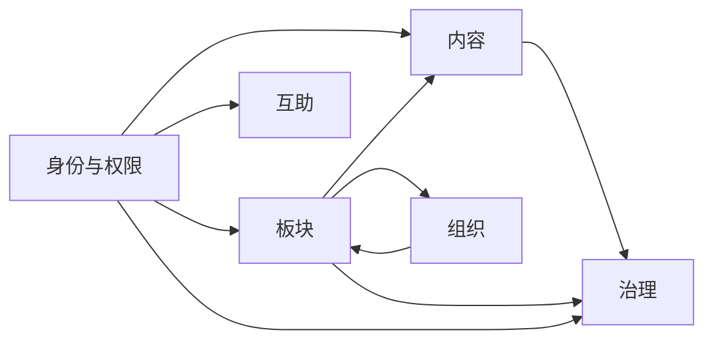
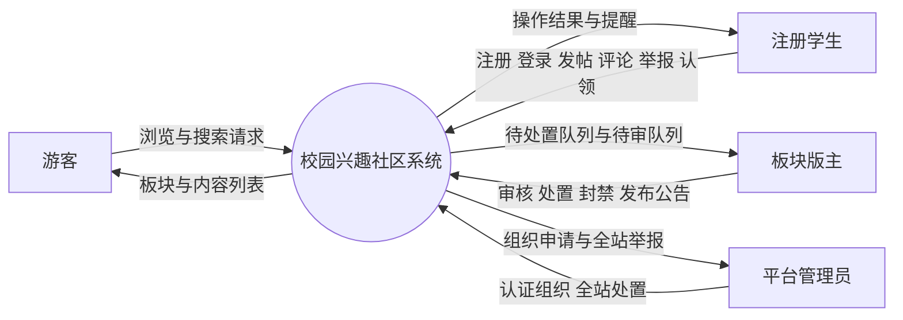
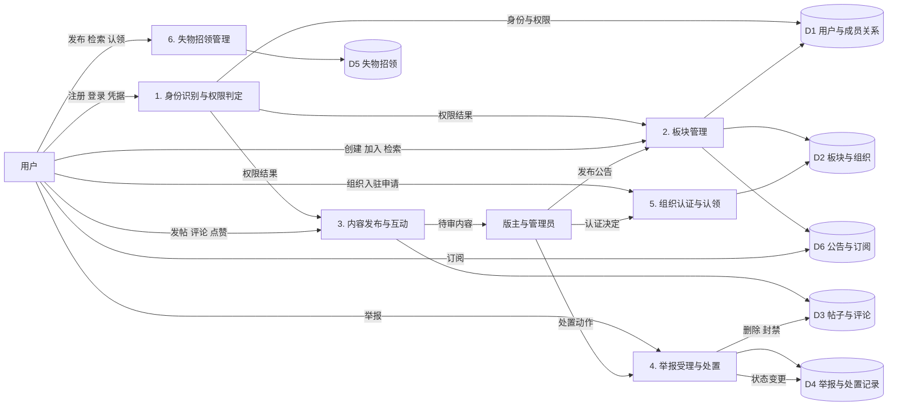
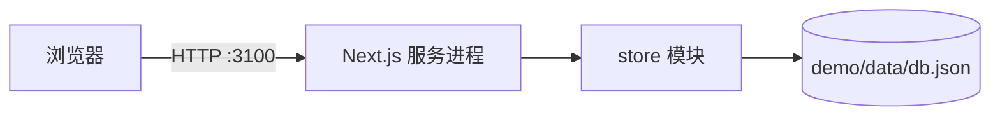

# 总体设计报告

> 项目：SchoolLifeComplex 校园兴趣社区
> 编写：软件设计员1
> 版本：初稿
> 输入：《需求分析报告》第九节的优先级清单
> 说明：本报告中描述的接口与模块划分，与 `demo/` 目录下的演示工程保持一一对应。

---

## 一、设计目标与原则

### 1.1 设计目标

把需求分析中的五个功能模块转化为可实现的系统结构，明确模块边界、数据流向、接口契约与部署形态，使详细设计能够直接进入编码。

### 1.2 设计原则

| 原则 | 含义 | 在系统中的体现 |
| --- | --- | --- |
| 权限在服务端判定 | 前端只负责显示，不做安全判断 | 所有写操作在接口层重新校验角色与成员关系 |
| 存储与业务分离 | 业务代码不直接操作存储介质 | 业务逻辑只调用 `store` 模块暴露的方法 |
| 模块按需求编号对齐 | 每个模块可追溯到需求 | 模块名与 FR-M1 至 FR-M5 一一对应 |
| 简化不留暗坑 | 演示级简化必须显式标注 | 会话机制与并发写入的简化在详细设计中逐条声明 |
| 读开放写受限 | 浏览无门槛 | 列表与详情接口不校验登录态 |

---

## 二、系统总体架构

### 2.1 分层结构

```mermaid
graph TD
  subgraph 表示层["表示层（浏览器）"]
    P1[首页：板块发现]
    P2[板块页：内容与公告]
    P3[帖子页：讨论]
    P4[治理台：审核与举报]
    P5[失物招领]
    P6[登录与注册]
  end

  subgraph 接口层["接口层（Next.js Route Handlers）"]
    A1[/api/auth/*]
    A2[/api/boards/*]
    A3[/api/posts/*]
    A4[/api/reports 与 /api/moderation/*]
    A5[/api/orgs/*]
    A6[/api/found-items/*]
  end

  subgraph 业务层["业务层（领域逻辑）"]
    B1[身份与权限]
    B2[板块与成员]
    B3[内容与互动]
    B4[治理与审核]
    B5[组织与认证]
    B6[失物招领]
  end

  subgraph 数据层["数据层"]
    D1[store：存储抽象]
    D2[(data/db.json)]
  end

  表示层 --> 接口层
  接口层 --> 业务层
  业务层 --> D1
  D1 --> D2
```

### 2.2 分层职责

| 层 | 职责 | 不负责 |
| --- | --- | --- |
| 表示层 | 渲染界面、收集输入、展示错误 | 不判断权限，不做业务规则 |
| 接口层 | 解析请求、调用领域逻辑、组织响应、统一错误格式 | 不包含业务规则，不直接读写文件 |
| 业务层 | 权限判定、状态流转、数据校验、业务规则 | 不关心 HTTP，不关心存储实现 |
| 数据层 | 数据持久化、主键生成、一致性写入 | 不包含业务规则 |

### 2.3 架构选择的理由

- **单体而非前后端分离部署**：演示场景下，前后端同源可以省掉跨域、独立部署与端口管理，减少现场出问题的概率。
- **接口层与业务层分离而非合并**：接口层只做协议转换，业务层可被测试直接调用，便于测试报告中对业务规则做独立验证。
- **存储抽象层**：这是唯一为"未来可能换数据库"预留的抽象。它换来的是可行性报告中"存储可替换"这一结论的成立。

---

## 三、模块划分

| 模块 | 对应需求 | 核心职责 | 关键数据结构 |
| --- | --- | --- | --- |
| 身份与权限模块 | M1 | 注册登录、会话识别、认证状态、角色与成员关系判定 | User、Membership |
| 板块模块 | M2 | 板块创建、检索、分类、加入、版主治理 | Board、Membership |
| 内容模块 | M3 | 发帖、评论、点赞、待审状态流转 | Post、Comment、Reaction |
| 治理模块 | M3 / M4 | 举报受理、处置动作、处置记录 | Report、ModerationAction |
| 组织模块 | M4 | 组织入驻、认证、板块认领、公告 | Organization、Announcement |
| 互助模块 | M5 | 失物招领发布、检索、认领 | FoundItem |

### 3.1 模块之间的依赖



- 身份与权限模块被所有模块依赖（任何写操作都要判定身份）。
- 内容模块依赖板块模块（发帖需要板块上下文与成员关系）。
- 治理模块横向依赖内容与板块，因为它需要判定"处置人是否有权处置这条内容所在板块"。
- 组织模块反向依赖板块（组织认领板块），这是系统中唯一的双向关系，实现时以板块侧持有 `organizationId` 外键解决，避免循环调用。

---

## 四、数据流图

### 4.1 顶层图（上下文图）



**外部实体的说明**：系统不接入任何外部系统。这一条是设计上刻意的边界——可行性研究报告第 4 节已经说明，接入学校官方系统会立刻引入数据授权与个人信息合规问题。因此上下文图中只有人，没有外部系统。

### 4.2 一层数据流图



### 4.3 数据字典（数据流与数据存储）

| 编号 | 名称 | 组成 | 说明 |
| --- | --- | --- | --- |
| D1 | 用户与成员关系 | 用户记录 + 成员关系记录 | 成员关系是权限判定的依据 |
| D2 | 板块与组织 | 板块记录 + 组织记录 | 板块可被组织认领 |
| D3 | 帖子与评论 | 帖子记录 + 评论记录 + 点赞记录 | 含状态字段 |
| D4 | 举报与处置记录 | 举报记录 + 处置动作 | 处置动作记录处置人与时间 |
| D5 | 失物招领 | 失物信息记录 | 含状态与认领人 |
| D6 | 公告与订阅 | 公告记录 + 订阅记录 | 公告人工发布，不抓取外部数据 |
| F1 | 注册登录凭据 | 学号 + 姓名 + 密码 | 密码以哈希形式入库 |
| F2 | 发帖数据流 | 板块标识 + 标题 + 正文 | 进入 D3，视板块配置决定是否待审 |
| F3 | 举报数据流 | 目标类型 + 目标标识 + 原因 | 进入 D4 |
| F4 | 处置动作 | 处置人 + 动作类型 + 时间 | 写入 D4 |

---

## 五、接口设计

### 5.1 接口约定

- 风格：HTTP + JSON，路径统一以 `/api` 开头。
- 认证：登录成功后下发会话 Cookie，服务端据此识别身份。
- 成功响应：`{ "ok": true, "data": ... }`。
- 失败响应：`{ "ok": false, "error": { "code": "...", "message": "..." } }`。
- 错误码语义：`UNAUTHORIZED` 未登录、`FORBIDDEN` 已登录但无权限、`NOT_FOUND` 目标不存在、`VALIDATION` 字段校验失败、`CONFLICT` 唯一性冲突。

### 5.2 接口清单

| 方法 | 路径 | 作用 | 权限 | 对应模块 |
| --- | --- | --- | --- | --- |
| POST | /api/auth/register | 注册 | 公开 | M1 |
| POST | /api/auth/login | 登录 | 公开 | M1 |
| POST | /api/auth/logout | 退出 | 登录 | M1 |
| GET | /api/me | 获取当前用户与会话状态 | 公开（未登录返回空） | M1 |
| GET | /api/boards | 板块列表、搜索、分类筛选 | 公开 | M2 |
| POST | /api/boards | 创建板块 | 登录 | M2 |
| GET | /api/boards/{slug} | 板块详情（含帖子、公告、成员状态） | 公开 | M2 |
| POST | /api/boards/{slug}/join | 加入板块 | 登录 | M2 |
| POST | /api/boards/{slug}/posts | 发帖 | 板块成员 | M3 |
| POST | /api/boards/{slug}/announcements | 发布公告 | 版主 | M4 |
| POST | /api/boards/{slug}/claim | 认领板块为组织官方阵地 | 组织所有者且为该板块版主 | M4 |
| POST | /api/boards/{slug}/members/{userId}/ban | 封禁或解封成员 | 版主 | M2 |
| GET | /api/posts/{id} | 帖子详情（含评论） | 公开（待审内容受限） | M3 |
| POST | /api/posts/{id}/comments | 评论 | 板块成员 | M3 |
| POST | /api/posts/{id}/like | 点赞或取消点赞 | 板块成员 | M3 |
| POST | /api/posts/{id}/moderate | 审核通过、驳回或删除帖子 | 版主 | M3 |
| POST | /api/reports | 提交举报 | 登录 | 治理 |
| GET | /api/moderation/reports | 待处置举报队列 | 版主或管理员 | 治理 |
| POST | /api/moderation/reports/{id} | 处置举报 | 版主或管理员 | 治理 |
| GET | /api/orgs | 组织列表 | 公开 | M4 |
| POST | /api/orgs | 申请组织入驻 | 登录 | M4 |
| POST | /api/orgs/{id}/verify | 认证或驳回组织 | 管理员 | M4 |
| GET | /api/found-items | 失物招领列表与筛选 | 公开 | M5 |
| POST | /api/found-items | 发布失物或招领信息 | 登录 | M5 |
| POST | /api/found-items/{id}/claim | 认领 | 登录 | M5 |
| POST | /api/found-items/{id}/close | 关闭信息 | 发布者或管理员 | M5 |

### 5.3 权限判定的统一入口

系统的权限判定集中在身份与权限模块的三个判断上，所有接口复用：

1. `requireUser()`：要求已登录。
2. `requireMembership(boardId, userId)`：要求是该板块成员且未被封禁。
3. `requireModerator(boardId, userId)`：要求是该板块版主或平台管理员。

这三个判断位于业务层，接口层只负责调用并把失败转换为对应的错误码。这样做的目的是让权限规则只有一处定义，避免出现"某个接口忘了校验"的漏洞。

---

## 六、数据存储设计

### 6.1 存储形态

演示环境使用单文件 JSON 存储（`demo/data/db.json`），由存储抽象模块统一读写。集合与需求分析中的实体一一对应：

`users`、`organizations`、`boards`、`memberships`、`posts`、`comments`、`reactions`、`reports`、`foundItems`、`announcements`、`subscriptions`。

### 6.2 存储抽象接口

| 方法 | 作用 |
| --- | --- |
| `read()` | 读取整份数据集（内部缓存） |
| `write(mutator)` | 以"读取—修改—整体写回"的方式提交变更 |
| `nextId(prefix)` | 生成带前缀的自增标识 |

### 6.3 关于并发写入的说明

文件型存储在并发写入下可能丢失更新。演示环境通过串行化写入（同一时刻只允许一个写操作进入临界区）降低风险，但这不是生产级方案。总体设计阶段如实标注，替换为关系型数据库时该问题自然消失。

---

## 七、技术选型说明

| 选型项 | 选择 | 备选 | 选择理由 |
| --- | --- | --- | --- |
| 应用框架 | Next.js（App Router） | Spring Boot + Vue、Django | 前后端同语言，单体部署，零额外服务 |
| 界面库 | React | Vue | 与 Next.js 同生态 |
| 图标库 | lucide-react | 自绘 SVG | 统一的图标规范，减少自绘成本 |
| 样式方案 | 原生 CSS 变量 | Tailwind、组件库 | 避免引入构建插件，降低环境风险 |
| 数据存储 | JSON 文件 + 存储抽象 | SQLite、MySQL | 零外部服务、零原生模块编译 |
| 会话机制 | Cookie 承载会话标识 | JWT、服务端会话表 | 实现最简，且演示场景不跨机器 |

---

## 八、部署与运行结构



- 运行方式：`npm run build` 构建，`npm run start` 启动，默认端口 3100。
- 无外部依赖：不连接数据库、不连接缓存、不连接第三方接口。
- 演示设备：任意可运行 Node 的电脑；访问端只需浏览器，手机与桌面均可。

---

## 九、界面结构与导航

| 页面 | 路径 | 面向角色 | 主要内容 |
| --- | --- | --- | --- |
| 首页 | / | 全体 | 板块列表、搜索、分类筛选、登录状态、创建板块入口 |
| 板块页 | /boards/{slug} | 全体 | 板块信息、认证标识、公告、帖子列表、加入与发帖 |
| 帖子页 | /posts/{id} | 全体 | 帖子正文、评论、点赞、举报 |
| 治理台 | /moderation | 版主、管理员 | 待审内容、举报队列、处置动作、组织认证 |
| 组织入驻 | /orgs | 全体（申请需登录） | 组织列表、入驻申请 |
| 失物招领 | /found | 全体 | 信息列表、筛选、发布、认领 |
| 登录注册 | /login | 未登录用户 | 注册与登录表单 |

导航原则：**板块页是系统的中心**。所有路径都以"进入一个板块"为终点，组织入驻、失物招领与治理台作为辅助入口出现在顶部导航。这与产品定位一致——内容是围绕板块组织的。

---

## 十、设计取舍说明

| 取舍 | 选择 | 放弃的方案 | 理由 |
| --- | --- | --- | --- |
| 内容与板块的关系 | 一个帖子只属于一个板块 | 帖子可跨板块 | 跨板块会让权限判定复杂化，且与"板块即阵地"的定位冲突 |
| 审核粒度 | 板块级开关 | 帖子级审核 | 板块级开关足够覆盖场景，实现成本低 |
| 举报的合并策略 | 同一内容的多条举报合并为一条待处置记录 | 每条举报独立处置 | 合并后处置动作不会重复，符合实际操作习惯 |
| 组织与板块关系 | 一个板块最多被一个组织认领，一个组织可认领多个板块 | 一个板块多个组织共管 | 共管会引入多方权限冲突，超出本期设计范围 |
| 公告形态 | 板块内公告 | 全局通知中心 | 通知中心属于降级掉的通知聚合，不再单独建设 |
