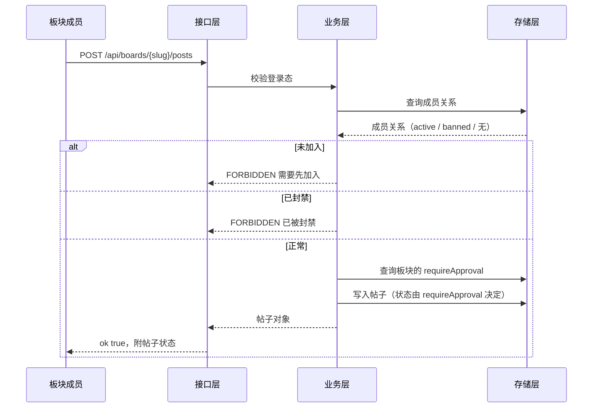
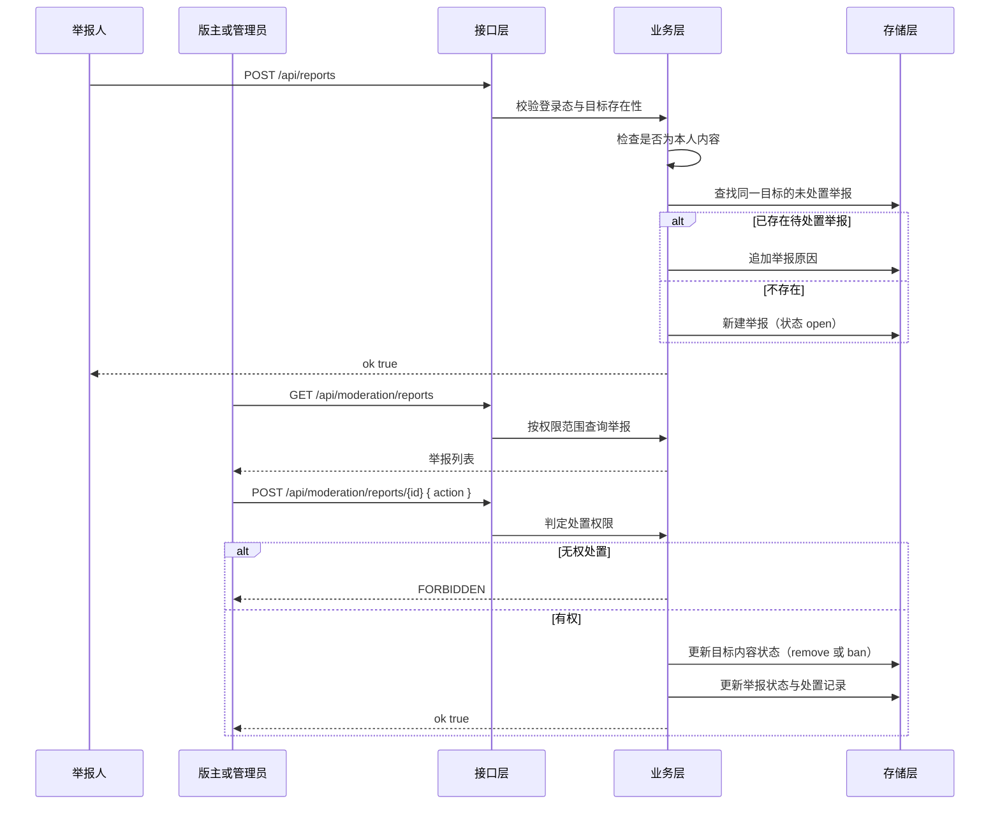
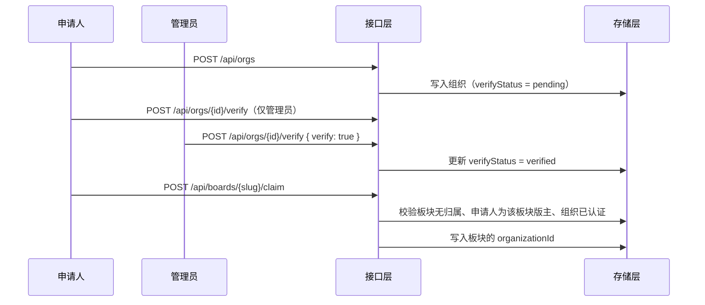

# 详细设计报告

> 项目：SchoolLifeComplex 校园兴趣社区
> 编写：软件设计员2
> 版本：初稿
> 输入：《总体设计报告》的模块划分与接口清单
> 说明：本报告的字段名、接口路径与错误码与 `demo/` 演示工程的实际实现完全一致，可直接用于代码走查。

---

## 一、引言

详细设计的任务是让编码阶段不再需要做设计决策。因此本报告给出到字段级的数据结构、到请求响应体的接口规格、到判定顺序的权限算法，以及关键流程的时序。

报告末尾单列"已知简化与待加固项"，把演示环境与生产级实现之间的差距写明，避免把演示代码当成可交付的正式系统。

---

## 二、数据结构详细设计

存储形态为单文件 JSON，集合与实体一一对应。所有标识由系统生成，格式为 `前缀_自增序号`，例如 `u_3`、`b_2`、`p_17`。

### 2.1 users（用户）

| 字段 | 类型 | 必填 | 默认值 | 说明 |
| --- | --- | --- | --- | --- |
| id | string | 是 | 生成 | 主键，前缀 `u` |
| studentNo | string | 是 | — | 学号，唯一，登录用，不对外展示 |
| name | string | 是 | — | 姓名 |
| passwordHash | string | 是 | — | `salt:sha256(salt + password)` |
| role | string | 是 | `student` | `student` / `admin` |
| verifyStatus | string | 是 | `none` | `none` / `pending` / `verified` |
| reputation | number | 是 | `100` | 信誉分 |
| createdAt | string | 是 | 当前时间 | ISO 时间字符串 |

### 2.2 boards（板块）

| 字段 | 类型 | 必填 | 默认值 | 说明 |
| --- | --- | --- | --- | --- |
| id | string | 是 | 生成 | 主键，前缀 `b` |
| slug | string | 是 | 由名称生成 | 唯一，用于访问路径 |
| name | string | 是 | — | 板块名称，唯一 |
| description | string | 是 | — | 简介 |
| category | string | 是 | `other` | `game` / `anime` / `sports` / `study` / `life` / `other` |
| requireApproval | boolean | 是 | `false` | 发帖是否需审核 |
| ownerUserId | string | 是 | — | 创建者 |
| organizationId | string \| null | 是 | `null` | 被认领的组织 |
| createdAt | string | 是 | 当前时间 | — |

**slug 生成规则**：对"名称 + 创建时间 + 随机值"计算 SHA-256 并取前八位作为后缀，形如 `board-1a2b3c4d`。它保证唯一、路径安全，且生成后不再随名称变化，避免已分享的链接失效。

### 2.3 memberships（成员关系）

| 字段 | 类型 | 必填 | 默认值 | 说明 |
| --- | --- | --- | --- | --- |
| id | string | 是 | 生成 | 主键，前缀 `m` |
| boardId | string | 是 | — | 所属板块 |
| userId | string | 是 | — | 成员 |
| role | string | 是 | `member` | `member` / `moderator` |
| status | string | 是 | `active` | `active` / `banned` |
| joinedAt | string | 是 | 当前时间 | — |

**唯一性约束**：`(boardId, userId)` 组合唯一。创建板块时自动为创建者写入一条 `role = moderator` 的成员关系。

### 2.4 posts（帖子）与 comments（评论）

| 字段 | 类型 | 必填 | 默认值 | 说明 |
| --- | --- | --- | --- | --- |
| id | string | 是 | 生成 | 前缀 `p` / `c` |
| boardId | string | 是 | — | 所属板块（评论为所属帖子） |
| authorId | string | 是 | — | 作者 |
| title | string | 帖子必填 | — | 评论无此字段 |
| body | string | 是 | — | 正文 |
| status | string | 是 | `published` | `pending` / `published` / `rejected` / `removed` |
| likeCount | number | 是 | `0` | 帖子专用，冗余计数便于排序 |
| createdAt | string | 是 | 当前时间 | — |

### 2.5 reactions（点赞）

| 字段 | 类型 | 必填 | 说明 |
| --- | --- | --- | --- |
| id | string | 是 | 主键，前缀 `r` |
| postId | string | 是 | 被点赞的帖子 |
| userId | string | 是 | 点赞人 |

**唯一性约束**：`(postId, userId)` 唯一。取消点赞时删除记录并同步递减帖子的 `likeCount`。

### 2.6 reports（举报）与处置记录

| 字段 | 类型 | 必填 | 默认值 | 说明 |
| --- | --- | --- | --- | --- |
| id | string | 是 | 生成 | 前缀 `rp` |
| targetType | string | 是 | — | `post` / `comment` |
| targetId | string | 是 | — | 目标标识 |
| boardId | string | 是 | — | 冗余存储，用于快速判定处置权限 |
| reporterId | string | 是 | — | 举报人 |
| reason | string | 是 | — | 举报原因 |
| status | string | 是 | `open` | `open` / `resolved` / `rejected` |
| handledBy | string \| null | 是 | `null` | 处置人 |
| handledAt | string \| null | 是 | `null` | 处置时间 |
| action | string \| null | 是 | `null` | `remove` / `ban` / `reject` |
| createdAt | string | 是 | 当前时间 | — |

**合并规则**：提交举报时，若存在同一 `targetType` + `targetId` 且状态为 `open` 的记录，则不再新建记录，只在原因中追加一条并记录新的举报人。

### 2.7 organizations（组织）

| 字段 | 类型 | 必填 | 默认值 | 说明 |
| --- | --- | --- | --- | --- |
| id | string | 是 | 生成 | 前缀 `o` |
| name | string | 是 | — | 组织名称，唯一 |
| kind | string | 是 | — | `club`（注册社团）/ `group`（自建小组） |
| description | string | 是 | — | 简介 |
| ownerUserId | string | 是 | — | 申请人，即组织所有者 |
| verifyStatus | string | 是 | `pending` | `pending` / `verified` / `rejected` |
| verifiedAt | string \| null | 是 | `null` | 认证时间 |
| createdAt | string | 是 | 当前时间 | — |

### 2.8 foundItems（失物招领）

| 字段 | 类型 | 必填 | 默认值 | 说明 |
| --- | --- | --- | --- | --- |
| id | string | 是 | 生成 | 前缀 `f` |
| kind | string | 是 | — | `lost`（寻物）/ `found`（招领） |
| title | string | 是 | — | 标题 |
| description | string | 是 | — | 描述 |
| location | string | 是 | — | 地点 |
| contact | string | 是 | — | 联系方式 |
| status | string | 是 | `open` | `open` / `claimed` / `closed` |
| authorId | string | 是 | — | 发布者 |
| claimedBy | string \| null | 是 | `null` | 认领人 |
| createdAt | string | 是 | 当前时间 | — |

### 2.9 announcements（公告）与 subscriptions（订阅）

| 字段 | 类型 | 必填 | 说明 |
| --- | --- | --- | --- |
| id | string | 是 | 公告主键，前缀 `an`；订阅主键前缀 `sub` |
| boardId | string | 是 | 所属板块 |
| authorId | string | 是 | 发布人（订阅记录无此字段） |
| title | string | 是 | 公告标题 |
| body | string | 是 | 公告正文 |
| createdAt | string | 是 | 发布时间 |

---

## 三、接口详细规格

### 3.1 通用约定

所有响应体形如：

```json
{ "ok": true, "data": {} }
```

```json
{ "ok": false, "error": { "code": "FORBIDDEN", "message": "需要先加入该板块" } }
```

### 3.2 身份与准入

| 接口 | 请求体 | 响应 data | 可能错误 |
| --- | --- | --- | --- |
| POST /api/auth/register | `{ studentNo, name, password }` | `{ user }` | `VALIDATION`（字段缺失）、`CONFLICT`（学号已存在） |
| POST /api/auth/login | `{ studentNo, password }` | `{ user }` | `VALIDATION`、`UNAUTHORIZED`（学号或密码错误） |
| POST /api/auth/logout | 无 | `{ ok: true }` | 无 |
| GET /api/me | 无 | `{ user: 用户或 null }` | 无 |

**字段校验规则**：学号为 4 至 20 位数字或字母；姓名 1 至 20 字符；密码 6 至 64 字符。

### 3.3 板块

| 接口 | 请求体 | 响应 data | 可能错误 |
| --- | --- | --- | --- |
| GET /api/boards?q=&category= | 无 | `{ boards: [...] }` | 无 |
| POST /api/boards | `{ name, description, category, requireApproval }` | `{ board }` | `UNAUTHORIZED`、`VALIDATION`、`CONFLICT`（名称重复） |
| GET /api/boards/{slug} | 无 | `{ board, posts, announcements, membership, organization }` | `NOT_FOUND` |
| POST /api/boards/{slug}/join | 无 | `{ membership }` | `UNAUTHORIZED`、`NOT_FOUND`、`CONFLICT`（已加入） |
| POST /api/boards/{slug}/posts | `{ title, body }` | `{ post }` | `UNAUTHORIZED`、`FORBIDDEN`（未加入或已封禁）、`VALIDATION` |
| POST /api/boards/{slug}/announcements | `{ title, body }` | `{ announcement }` | `UNAUTHORIZED`、`FORBIDDEN`（非版主） |
| POST /api/boards/{slug}/claim | `{ organizationId }` | `{ board }` | `FORBIDDEN`（非组织所有者或非本板块版主）、`CONFLICT`（板块已被认领） |
| POST /api/boards/{slug}/members/{userId}/ban | `{ banned: boolean }` | `{ membership }` | `FORBIDDEN`（非版主）、`VALIDATION`（不能封禁自己） |

**GET /api/boards/{slug} 的可见性规则**：返回的 `posts` 中，`published` 状态对所有人可见；`pending` 与 `rejected` 仅对作者本人与版主可见；`removed` 对所有人不可见（管理员通过治理台查看）。

### 3.4 内容与互动

| 接口 | 请求体 | 响应 data | 可能错误 |
| --- | --- | --- | --- |
| GET /api/posts/{id} | 无 | `{ post, comments, board, canInteract }` | `NOT_FOUND` |
| POST /api/posts/{id}/comments | `{ body }` | `{ comment }` | `UNAUTHORIZED`、`FORBIDDEN`、`VALIDATION` |
| POST /api/posts/{id}/like | 无 | `{ liked, likeCount }` | `UNAUTHORIZED`、`FORBIDDEN`（未加入板块）、`NOT_FOUND` |
| POST /api/posts/{id}/moderate | `{ action }`，取值为 `approve` / `reject` / `remove` | `{ post }` | `FORBIDDEN`（非版主）、`VALIDATION`（非法动作） |

### 3.5 治理

| 接口 | 请求体 | 响应 data | 可能错误 |
| --- | --- | --- | --- |
| POST /api/reports | `{ targetType, targetId, reason }` | `{ report, merged }` | `UNAUTHORIZED`、`NOT_FOUND`、`VALIDATION`（不能举报自己的内容） |
| GET /api/moderation/reports | 无 | `{ reports, pendingPosts, organizations }` | `FORBIDDEN`（既非版主也非管理员） |
| POST /api/moderation/reports/{id} | `{ action }`，取值为 `remove` / `ban` / `reject` | `{ report, target }` | `FORBIDDEN`（无权处置该板块）、`VALIDATION`（举报已处置） |
| POST /api/orgs/{id}/verify | `{ verify: boolean }` | `{ organization }` | `FORBIDDEN`（非管理员） |

**治理台的返回范围**：版主只看到自己所属板块的举报与待审内容；管理员看到全部。

### 3.6 组织与互助

| 接口 | 请求体 | 响应 data | 可能错误 |
| --- | --- | --- | --- |
| GET /api/orgs | 无 | `{ organizations }` | 无 |
| POST /api/orgs | `{ name, kind, description }` | `{ organization }` | `UNAUTHORIZED`、`VALIDATION`、`CONFLICT` |
| GET /api/found-items?q=&kind= | 无 | `{ items }` | 无 |
| POST /api/found-items | `{ kind, title, description, location, contact }` | `{ item }` | `UNAUTHORIZED`、`VALIDATION` |
| POST /api/found-items/{id}/claim | 无 | `{ item }` | `UNAUTHORIZED`、`CONFLICT`（已被认领或已关闭）、`VALIDATION`（不能认领自己发布的） |
| POST /api/found-items/{id}/close | 无 | `{ item }` | `FORBIDDEN`（非发布者且非管理员） |

---

## 四、关键流程时序

### 4.1 发帖（含审核分支）



### 4.2 举报与处置



### 4.3 组织认证与板块认领



---

## 五、权限判定算法

```text
function requireUser(session):
    user = findUser(session.userId)
    if user is null: raise UNAUTHORIZED
    return user

function requireMembership(user, boardId):
    if user.role == "admin": return OK
    membership = findMembership(boardId, user.id)
    if membership is null: raise FORBIDDEN("需要先加入该板块")
    if membership.status == "banned": raise FORBIDDEN("已被该板块封禁")
    return membership

function requireModerator(user, boardId):
    if user.role == "admin": return OK
    membership = findMembership(boardId, user.id)
    if membership is null or membership.role != "moderator":
        raise FORBIDDEN("需要版主权限")
    return membership

function canViewPost(post, user, membership):
    if post.status == "published": return true
    if post.status == "removed": return false
    # pending 或 rejected
    if user is null: return false
    if user.id == post.authorId: return true
    return membership is not null and membership.role == "moderator"
```

**判定顺序的重要性**：`requireMembership` 先判是否管理员，再判成员关系，最后判封禁状态。管理员绕过的是"成员关系"这一层，不绕过"目标存在性"校验。顺序写反会导致管理员在未加入的板块被拒绝。

---

## 六、状态机的实现说明

状态字段的取值与允许的转换，全部集中在业务层的动作函数中，不允许接口层直接改写状态字段。

| 状态机 | 字段 | 允许的写入动作 |
| --- | --- | --- |
| 用户认证 | users.verifyStatus | 提交认证（none 转 pending）、管理员核验（pending 转 verified 或 none） |
| 板块成员 | memberships.role / status | 加入（新建 member/active）、授予或收回版主、封禁与解封 |
| 帖子 | posts.status | 发帖（按板块配置写 published 或 pending）、审核通过或驳回、删除 |
| 举报 | reports.status | 新建（open）、处置（resolved）、驳回（rejected） |
| 失物招领 | foundItems.status | 发布（open）、认领（claimed）、关闭（closed） |
| 组织 | organizations.verifyStatus | 申请（pending）、认证（verified）、驳回（rejected） |

**实现约束**：每个动作函数在写入前校验当前状态是否允许该转换，非法转换返回 `VALIDATION` 错误而不是静默失败。例如对一条已处置的举报再次处置会被拒绝。

---

## 七、界面设计

### 7.1 全局结构

- 顶部导航：站点名称、板块发现、失物招领、治理台（有权限时才显示）、登录状态与用户名。
- 页面主体：单列内容流，最大宽度受限，移动端自动收窄。
- 视觉基调：以中性灰白为底，单一强调色用于主要动作与认证标识；卡片用于重复出现的列表项（板块、帖子、失物信息），圆角不超过 8 像素。

### 7.2 各页面的关键交互

| 页面 | 关键元素 | 交互要点 |
| --- | --- | --- |
| 首页 | 搜索框、分类筛选、板块卡片列表 | 搜索与筛选即时生效；未登录也能使用 |
| 板块页 | 板块标题、认证标识、公告区、成员状态按钮、发帖表单、帖子列表 | 未加入时发帖表单显示为禁用并给出加入入口；已加入时直接可用 |
| 帖子页 | 帖子正文、点赞按钮、举报按钮、评论区 | 举报要求选择原因；待审帖对作者显示醒目标记 |
| 治理台 | 待审内容区、举报队列、组织认证区 | 每个举报项直接给出处置动作；处置后即时从队列移除 |
| 组织入驻 | 组织列表、入驻申请表单 | 展示认证状态；提交后进入待认证状态 |
| 失物招领 | 类型筛选、搜索、信息列表、发布表单 | 已认领的信息以状态标记，不再显示认领按钮 |
| 登录注册 | 表单、错误提示 | 登录与注册在同一页面用分段控件切换 |

### 7.3 按钮与图标的使用约定

- 图标按钮（点赞、举报、关闭、返回）使用图标库，并提供悬浮提示说明含义。
- 主要动作使用带文字的按钮，次要动作用图标按钮。
- 危险动作（删除、驳回、封禁）使用区分色，并在按钮上写明动作名称。

---

## 八、错误码清单

| 错误码 | HTTP 状态 | 含义 | 前端处理 |
| --- | --- | --- | --- |
| UNAUTHORIZED | 401 | 未登录或会话失效 | 提示并引导到登录 |
| FORBIDDEN | 403 | 已登录但无权限 | 就地提示原因 |
| NOT_FOUND | 404 | 目标不存在 | 显示空状态 |
| VALIDATION | 400 | 字段校验失败 | 在对应表单字段上提示 |
| CONFLICT | 409 | 唯一性冲突或状态冲突 | 提示具体冲突原因 |

---

## 九、已知简化与待加固项

以下内容是演示环境的刻意简化，**不是设计缺陷被忽略，而是明确记录在案的加固清单**：

| 编号 | 简化项 | 风险 | 加固方式 |
| --- | --- | --- | --- |
| S1 | 会话 Cookie 未签名、无过期时间 | 伪造会话可越权 | 引入签名 Cookie 或服务端会话表 |
| S2 | 无访问频率限制 | 可被批量注册或刷举报 | 增加接口级限流 |
| S3 | 无自动化内容识别 | 违规内容依赖人工发现 | 接入关键词过滤与人工复核流程 |
| S4 | 文件型存储的并发写入 | 高并发下可能丢失更新 | 替换为关系型数据库 |
| S5 | 密码仅做加盐哈希，无强度策略 | 弱密码可被猜测 | 增加强度校验与登录失败锁定 |
| S6 | 无密码找回 | 忘记密码即无法登录 | 演示环境由管理员重置 |
| S7 | 图片等富媒体未支持 | 内容表现力受限 | 后续引入对象存储 |

---

## 十、实现与设计的对应关系

| 设计内容 | 演示工程中的位置 |
| --- | --- |
| 存储抽象 | `demo/src/lib/store.js` |
| 身份与权限判定 | `demo/src/lib/auth.js` |
| 领域动作与状态流转 | `demo/src/lib/domain.js` |
| 接口层 | `demo/src/app/api/**/route.js` |
| 界面 | `demo/src/app/**/page.js` |
| 全局样式 | `demo/src/app/globals.css` |
